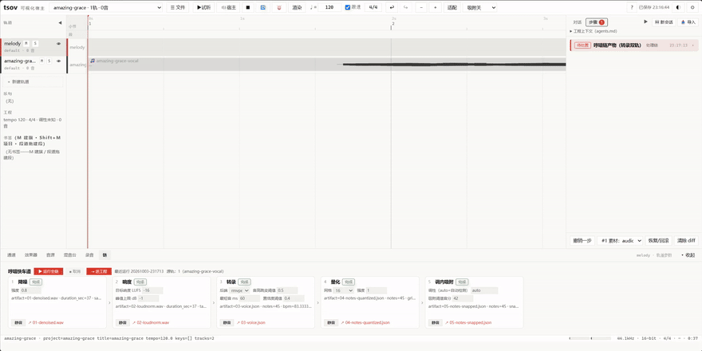
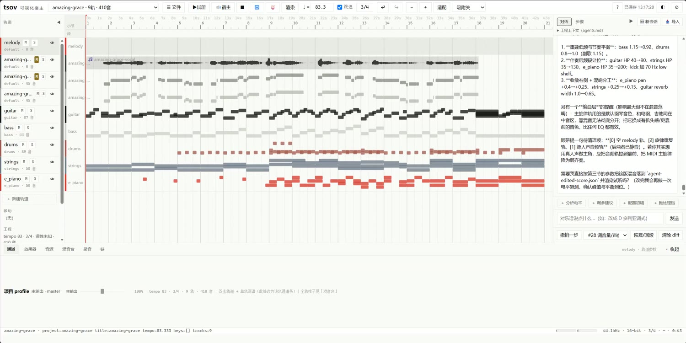
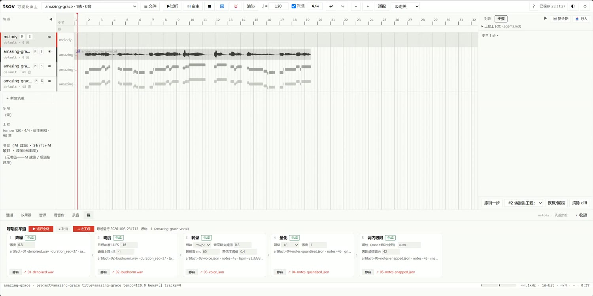
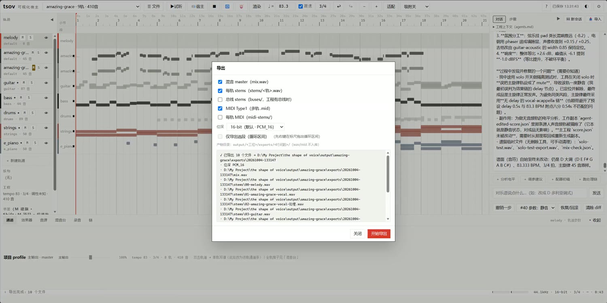
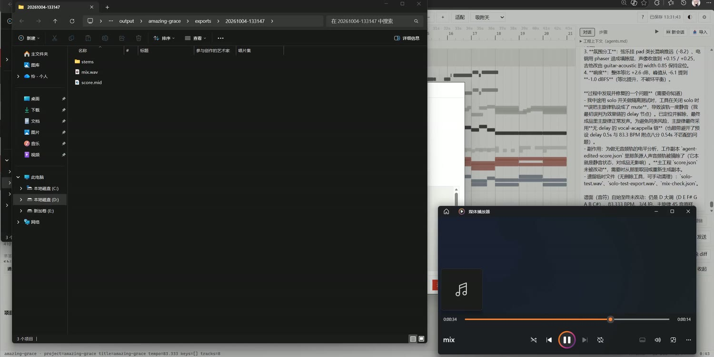

# tsov — the shape of voice

**[简体中文](README.zh-CN.md) | English**

> **Hum it — get a song you can keep editing.**
> tsov is a local-first, AI-native music workspace: hum a melody, and an LLM agent works on a real music project *with* you — transcribing, arranging, mixing, exporting — through one shared command layer where every action is visible, undoable, and reversible.



**Demo video (2:14)** — English & 中文 versions are attached to the [v0.1.0 release](https://github.com/luolianst/tsov/releases/latest); the Chinese version is also up on **[Bilibili](https://www.bilibili.com/video/BV1XEHE6bEjP/)**. The demo covers the full loop: import a humming recording → transcribe → adopt MIDI → four rounds of agent chat (arrangement, orchestration, mixing guidance, mix & export) → listen to the result.

| Workspace & chat | Humming quick-lane | Export | Play the result |
|---|---|---|---|
|  |  |  |  |

## What it does

tsov turns “I can hum it, but I can't write it” into a real, editable music project:

| Step | What happens |
|---|---|
| 🎤 **Hum** | Record a voice memo and import it (or any audio / MIDI file). |
| 🎼 **Transcribe** | One click runs the **humming quick-lane**: denoise → loudnorm → transcribe (RMVPE for humming, GAME for produced vocals) → quantize → scale-snap. Every step keeps its artifacts; adopt the final result to the project as an editable MIDI track. |
| 💬 **Talk** | Chat with an agent that edits the project for you: “set the tempo to its natural speed and give me a folk arrangement”, “analyze this melody and orchestrate it”, “guide the mix”, “mix it and export”. Every round shows up as reviewable diffs and action cards — with undo. |
| 🎛 **Work** | A real workspace in your browser: piano-roll score editor (full score ↔ single-track), multi-track arrangement, buses & effect chains (pedalboard), automation lanes, metering, audio clips with non-destructive editing, recording with monitoring. |
| 📦 **Export** | Master mix / stems / buses / MIDI; 16/24/32-bit; range export; everything lands in a timestamped `exports/` folder. |

The whole loop runs **locally** in a browser UI served by `tsov web`. The only cloud piece is the LLM endpoint you configure.

## Design principles

- **Humans and agents share one path.** Every feature — UI control, REST endpoint, or agent tool — goes through the same transactional command layer (validated `EditBatch` edits). Agents get no side doors; humans get no magic buttons. Every change is versioned, diffable, and undoable. → [ADR-0017](docs/decisions/0017-共享动作路径.md), [docs/decisions](docs/decisions)
- **Nothing is a black box.** LLM edits are proposed as actions, applied as transactions, and shown as diffs. The deterministic parts (rendering, transcription plumbing, mixing, export) are plain Python with a 600+ test suite.
- **Local-first.** Your audio and projects stay on your machine. Only LLM calls leave it — to the endpoint you configure.

## Quickstart

**Requirements:** Windows 10/11 (primary target; macOS/Linux should mostly work but is untested) · Python 3.12 + [uv](https://docs.astral.sh/uv/) · ffmpeg on `PATH`.

```bash
git clone https://github.com/luolianst/tsov && cd tsov
uv venv tsov/.venv --python 3.12
uv pip install --python tsov/.venv -e .

# give tsov an LLM key (DeepSeek by default; any OpenAI-compatible endpoint works)
echo "TSOV_LLM_API_KEY=sk-your-key" > .env   # …or: cp .env.example .env, then edit it
# …or skip this and fill the key in the WebUI after startup: ⚙ Settings → Chat / LLM

# start the web workspace
tsov/.venv/Scripts/tsov.exe web --host 127.0.0.1 --port 8790   # Windows
# tsov/.venv/bin/tsov web --host 127.0.0.1 --port 8790          # macOS / Linux
```

Open **http://127.0.0.1:8790**, then:

1. ☰ File → New project.
2. Import a humming recording (or any audio / MIDI).
3. Right-click the audio track → **Transcribe to score…** → in the quick-lane panel click **Run full chain**.
4. **Adopt** the steps — MIDI tracks land in the project.
5. Open the chat panel and start talking about your song.

### Engines to provide (not bundled)

Large third-party binaries are **not** shipped in this repo (size/licensing). For the full experience, place them under `vendor/`:

| Engine | Purpose | Expected path | Get it from |
|---|---|---|---|
| FluidSynth 2.x DLL | MIDI rendering / playback | `vendor/fluidsynth/bin/libfluidsynth-3.dll` | [FluidSynth releases](https://github.com/FluidSynth/fluidsynth/releases) |
| `FluidR3_GM.sf2` soundfont | GM instruments | `vendor/soundfonts/FluidR3_GM.sf2` | [FluidR3_GM](https://member.keymusician.com/Member/FluidR3_GM/index.html) |
| RMVPE (`rmvpe.pt`) | Humming transcription | `vendor/RMVPE/rmvpe.pt` | [RVC Project](https://github.com/RVC-Project/Retrieval-based-Voice-Conversion-WebUI) |
| [GAME](https://github.com/openvpi/GAME) | Produced-vocal transcription | `vendor/GAME/` | openvpi/GAME |
| `htdemucs` / `htdemucs_ft` weights ([demucs](https://github.com/facebookresearch/demucs)) | Song decomposition — stem separation | HuggingFace cache (`adefossez/HTDemucs`, `HTDemucs-ft`) | [demucs](https://github.com/facebookresearch/demucs) |
| `vocals_mel_band_roformer` ([python-audio-separator](https://github.com/nomadkaraoke/python-audio-separator)) | High-quality vocal separation | `vendor/audio-separator-models/` | [python-audio-separator releases](https://github.com/nomadkaraoke/python-audio-separator/releases) |
| [ADTOF-pytorch](https://github.com/xavriley/ADTOF-pytorch) | Drum transcription | `vendor/ADTOF-pytorch/` | xavriley/ADTOF-pytorch |
| [YourMT3](https://github.com/mimbres/YourMT3) checkpoint (`mt3-infer`) | Bass / everything-else transcription | `vendor/mt3-checkpoints/` | mimbres/YourMT3 |
| Dexed (VST3 synth) · TAL-Chorus-LX (chorus) | VST3 instrument & effect support (the demo-tested pair) | `vendor/vst3/` | [Dexed](https://github.com/asb2m10/dexed) · [TAL](https://tal-software.com/products/tal-chorus-lx) |

**Shortcut:** `python scripts/fetch_engines.py` downloads and places everything above and runs quick functional checks (GAME's venv wiring and the pinned MT3 install included). The separation / drums / multi-instrument steps additionally use the `demucs`, `audio-separator` and `mt3-infer` Python packages — tested install commands are in [docs/setup-engines.md](docs/setup-engines.md) §2f–§2i, along with the manual walkthrough.

Without these, the web UI, score editing, mixing and MIDI import/export still work — audio rendering, transcription and song decomposition won't.

### One-click Windows bundle (optional)

For a fully self-contained share (embeds the Python runtime, all dependencies, the engines above and ffmpeg — nothing to install on the target machine), build the netdisk-style bundle:

```bash
python scripts/make_bundle.py          # stage + self-check + zip to your Desktop
```

The result extracts to any folder; double-click `启动tsov.bat` and the workspace opens in the browser. First run: fill your LLM key via **⚙ Settings → Chat / LLM** (or skip — everything but the AI chat works without a key).

**Prebuilt v0.1.5 (win64, 3.7 GB)** — use it without building: **[Quark Drive mirror](https://pan.quark.cn/s/5492bdc95fb8?pwd=WYgU)** (China; Quark account required — the package exceeds GitHub's release-asset limit, so it's distributed via the mirror).

### Configure the LLM

A commented template lives at **[`.env.example`](.env.example)** — `cp .env.example .env`, fill in your key, done. Defaults: `https://api.deepseek.com` · model `deepseek-v4-flash`. Override any of it with environment variables (or `.env`):

- `TSOV_LLM_API_KEY` — your key (also accepts `DEEPSEEK_API_KEY`)
- `TSOV_LLM_ENDPOINT` — e.g. `https://api.deepseek.com/v1/chat/completions`
- `TSOV_LLM_MODEL` — model name

…or fill it right in the WebUI — **⚙ Settings → Chat / LLM**: key, endpoint and model, stored locally in `tsov-settings.json` (environment variables / `.env` still take priority, the panel shows which layer is active). There's a built-in **Test connection** button.

## Architecture

```
hum / audio / MIDI ──► tsov core (dsp · analysis · midi · render · host)
                          │   one shared command layer (EditBatch transactions)
                          ▼
                tsov web workspace  ⇄  agent loop (LLM tool-calling)
                  (FastAPI + vanilla-JS frontend)
```

- **`tsov/`** — the package: `core/` (units, key, snap), `dsp/` (transcription backends: rmvpe / game), `chain/` (humming quick-lane), `midi/`, `render/`, `host/` (engine: mixing · buses · effects · transport · export), `analysis/`, `arrange/`, `tune/`, `agent/` (tool loop + skills), `webapp/` + `web/` (FastAPI + zero-build vanilla ES-module frontend), `eval/`, `pipeline.py`, `cli.py`.
- **`presets/`** — effect-chain & arrangement presets (14 + 6), each with provenance notes.
- **`tests/`** — unit / smoke / compare suites (600+ tests).
- **`docs/`** — [decisions/](docs/decisions) (**ADR design records** — start here for the deep dive) · the user guide (`tsov功能表.md`, 中文).
- **`.github/`** — issue templates · **`scripts/`**, **`vendor/`** (not shipped).

For the deeper story — why a command layer, why AGPL, how the agent loop works — read the ADRs. The short version: this project was built by a human and an agent working as peers.

## Status: v0.1 (prototype)

tsov is young, and honest about it. The full pipeline already runs end to end (hum → transcribed MIDI → agent arrangement → mix → mastered export — see the demo), but:

- **UI language: Chinese / English (switchable).** Pick 中文 or English under ⚙ Settings → 语言 / Language (or open the app with `?lang=en`). The [glossary](docs/glossary.md) maps every UI term to English (and to its DAW equivalent).
- **Windows-first.** macOS/Linux are untested.
- **Prototype quality.** Expect rough edges; breaking changes are possible before v1.0.
- **The agent needs an LLM key.** Everything else runs offline.
- **v0.2 in progress.** Batch E landed: finished-song decomposition — segment 1 (grid detection → 4-stem separation → vocal transcription → quantize/scale-snap → one-click multi-track placement) and **segment 2** (drums via ADTOF, bass/others via MT3/YourMT3 — full 4-stem transcription, 13-step chain, per-step addressing) — alongside the humming quick-lane, all driven from the same chain panel.
- **Realtime host (v0.2, S2.9).** The JUCE sidecar now plays VST3 and GM SoundFont tracks through one transport, with sample-accurate looping, output-latency-compensated playhead, editor-state reload, and sidecar recording/monitoring; the Web play button uses the sidecar for these projects and the Web record button uses the sidecar first (legacy `_recorder` fallback; audio/unknown sources still fall back to the legacy path).
- **MCP interface (experimental).** `tsov mcp` runs a stdio MCP server: external agents (Claude Code, Hermes, Codex, …) can list, read, edit, render and export projects through the same action layer the built-in agent uses — edits stay reviewable and reversible.

## Contributing

See [CONTRIBUTING.md](CONTRIBUTING.md). Issues and small PRs are welcome; for big changes, open an issue first. Solo project — best-effort support, no SLA.

## License

[AGPL-3.0](LICENSE). Use it, modify it, share it — but if you run a modified version as a network service, you must share your source. This keeps tsov from being swallowed by a closed-source clone.

---

<sub>Built on the shoulders of: [FluidSynth](https://www.fluidsynth.org/) · [pedalboard](https://github.com/spotify/pedalboard) · [librosa](https://librosa.org/) · [pretty_midi](https://github.com/craffel/pretty-midi) · [FastAPI](https://fastapi.tiangolo.com/) · [MCP](https://modelcontextprotocol.io) · [RMVPE](https://github.com/Dream-High/RMVPE) · [GAME](https://github.com/openvpi/GAME) · [demucs](https://github.com/facebookresearch/demucs) · [python-audio-separator](https://github.com/nomadkaraoke/python-audio-separator) · [ADTOF](https://github.com/xavriley/ADTOF-pytorch) · [YourMT3](https://github.com/mimbres/YourMT3) — and an agent that never sleeps.</sub>
